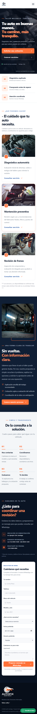

# AutoFix Santiago 🚗

Landing page responsive para un taller mecánico ficticio ubicado en Santiago de Chile. Este proyecto fue desarrollado como parte de mi aprendizaje de desarrollo frontend, con foco en diseño UI/UX, estructura semántica y adaptación a distintos dispositivos.

🔗 **[Ver sitio web publicado](https://autofix-santiago.netlify.app/)**

## 📸 Capturas de pantalla

### Vista de escritorio

  

### Vista móvil



## 🛠️ Tecnologías utilizadas

- **HTML5:** estructura semántica del sitio.
- **CSS3:** estilos, diseño responsive y adaptación a dispositivos móviles.
- **JavaScript:** interactividad y comportamiento del formulario de contacto.
- **Git y GitHub:** control de versiones y alojamiento del código.
- **Netlify:** despliegue y publicación del sitio web.

## ✨ Funcionalidades

- Diseño responsive para escritorio, tablet y móvil.
- Navegación entre las distintas secciones de la página.
- Sección principal con llamadas a la acción.
- Tarjetas con los servicios del taller.
- Presentación del negocio e información de contacto.
- Formulario que prepara una solicitud de atención para WhatsApp.
- Despliegue público mediante Netlify.

## 📁 Estructura del proyecto

```text
autofix-santiago/
├── index.html
├── styles.css
├── script.js
├── assets/
│   └── logo-autofix.jpg
└── README.md
```

## 🚀 Ejecución local

1. Clona el repositorio:

   ```bash
   git clone https://github.com/CristianP7/AutoFix-Santiago.git
   ```

2. Entra en la carpeta del proyecto:

   ```bash
   cd autofix-santiago
   ```

3. Abre `index.html` en tu navegador o utiliza la extensión Live Server de VS Code.

## 📚 Aprendizajes

Este proyecto me permitió practicar la construcción de una landing page desde cero, organizar HTML, CSS y JavaScript en archivos separados, trabajar con diseño responsive y publicar una web mediante un flujo de trabajo con GitHub y Netlify.

## ⚠️ Aviso

AutoFix Santiago es un proyecto ficticio creado con fines educativos y de portafolio. Los datos comerciales y de contacto son ilustrativos; el formulario no confirma reservas automáticamente.

## 👨‍💻 Autor

Proyecto personal de aprendizaje frontend.